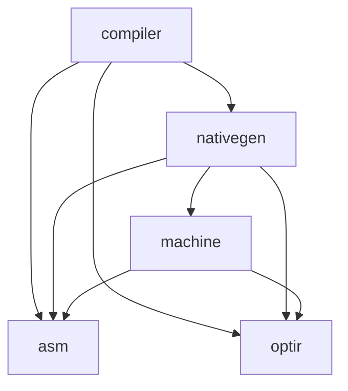
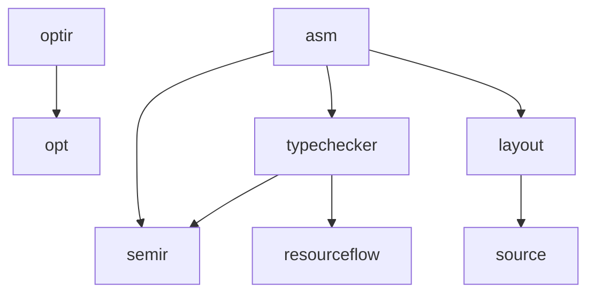

# A01: compiler and native architecture inventory

Baseline: `specification` commit `349fb7300943d7db9ebd46f76673cbd386d074b2`
(20 October 2026). Scope: `compiler/`, `asm/`, `nativegen/`, `machine/`,
`optir/`, including their subpackages. This is an inventory and refactor plan,
not an implementation of the proposed refactors or a new verification claim.

## Evidence and reproduction

Read together with the normative [backend contract](../spec/90-backend.md),
[assembler contract](../spec/94-assembler.md),
[target maturity matrix](../targets.md),
[architecture consolidation history](../notes/architecture-consolidation-2026-10.md),
and [target pipeline](../notes/target-pipeline-2026-09.md).
The code, rather than an older status paragraph, determines the observations below.

The checked-in [dependency inventory](a01-dependencies.json) contains every
module-local production/test import edge with its source filenames, package
counts, scope dependency closure, direct external consumers, cyclic components,
largest scoped files, and exact-body duplication candidates.

```sh
go run ./cmd/oak-architecture -root . -out /tmp/a01-dependencies.json
go test ./cmd/oak-architecture -count=1
go vet ./cmd/oak-architecture
```

The tool uses Go's parser, not an import regular expression. It includes all
build-tag/platform variants, generated Go, and scoped generator subpackages;
it excludes nested modules, hidden directories, `vendor` and `testdata`.
Thus this is a conservative **source union**, not the dependency graph of one
binary. `ProductionClosure` seeds every scoped package, including generator
commands: `spec/lean` in that closure does not mean a production compiler binary
links Lean. Standard-library and third-party imports are outside this
module-local map. Oak source-language imports, runtime calls, dynamic plugins,
Lean imports and generated C linkage are not Go import edges. Tests are reported
separately, with external test packages suffixed `_test`.

The snapshot is a baseline, not a permanently frozen golden file. Regenerate
it for future architecture reviews; unrelated source edits will change counts
and source-site positions. The regression test instead enforces directional
boundaries transitively and rejects cycles in the scoped production closure.
These checks run through the existing `packages-rest` CI inventory.

## Package dependency maps

Arrows mean direct **production import**, not semantic authority or execution
order. Among the five root packages, the complete graph is:



`compiler` does **not** directly import `machine` in production; its tests do.
The complete root-package outgoing module-local edges are:

| Package | Direct dependencies outside the five roots |
| --- | --- |
| `compiler` | `ast`, `bitwisecheck`, `borrowchecker`, `codegen`, `codegen/lean`, `codegen/metal`, `diagnostic`, `discipline`, `evaluator`, `hostform`, `layout`, `lowering`, `lsp`, `modules`, `object`, `opt`, `packageapi`, `parser`, `scanner`, `semir`, `source`, `stdlib`, `target`, `token`, `typechecker`, `wasm`, `wasm/check` |
| `asm` | `ast`, `layout`, `parser`, `scanner`, `semir`, `token`, `typechecker` |
| `nativegen` | `ast`, `opt`, `semir`, `token`, `typechecker` |
| `machine` | `ast` |
| `optir` | `opt` |

The relevant lower-layer graph is:



This second diagram highlights selected edges; the JSON contains all edges.
`asm` is already coupled to checked frontend types and source expressions; it
is not an isolated instruction encoding library. `optir` imports `opt` for
artifact/preservation vocabulary (`optir/aspects.go`), while `opt` has no
module-local production imports. Reversing that edge would introduce a cycle.

Direct consumers outside scope are `.`, `benchmarks/native/emit`,
`benchmarks/native/exact_fma`, `codegen`, `experiments/verification-poc/frontend`,
`lsp/server`, `playground`, `prove`, `repl`, `testrunner`,
`tools/checked_bundle/emit`, `tools/native_image_fixtures`,
`tools/native_object_fixtures`, `tools/source_image_parity`, and `wasm`.
The edge records identify which scoped package each consumes. In particular,
`codegen -> asm` and `wasm -> optir` enlarge the impact of ostensibly native-only
API changes.

Test imports within scope are `compiler -> asm/machine/nativegen/optir`,
`compiler_test -> compiler/asm`, `machine -> asm/optir`, and
`nativegen -> asm/machine/optir`. They do not create production import edges.
Do not move compiler integration fixtures into an internal `asm` test package
if they need to import `compiler`: use an external test package or integration
package to avoid a test compilation cycle.

## Ownership and authority boundaries

Ownership here means architectural responsibility, not a person assignment.
No CODEOWNERS file was present in the inspected checkout; do not infer reviewer
ownership from author history.

| Owner | Inputs and outputs / source anchors | Boundary to preserve |
| --- | --- | --- |
| `compiler` | Checked source orchestration; `compilation.go`, `optir.go`, `native_bodies.go`, `native_search.go`; produces candidates, emission reports and admitted output | Owns source context, exact call identity and admission policy; hashes, optimization costs and reports alone cannot confer a proved verdict |
| `nativegen` | Checked AST, typechecker facts and `Lane` through `CompileFor` / `CompileSession`; emits `asm.Function`; `nativegen.go`, `rv64.go`, `compile_session.go` | Untrusted producer; frame/register choices and transform proposals must still pass the independent seam checker and verifier |
| `machine` | Lifts `asm.Function` into explicit use/def CFG; allocates, schedules and lowers; also selects OptIR through `optir_aarch64.go` and `optir_rv64.go` | Untrusted transformations; `target.go` owns instruction-shape/ABI constraints for these algorithms, not proof authority |
| `asm` | Typed assembly representation, seam checking, symbolic verification, encoding and object support; `unit.go`, `check.go`, `rv64_check.go`, `verify.go`, `verify_calls.go`, `verify_native_policy.go`, `encode.go` | Distinguish syntax/encoding, ABI legality and semantic verdicts; checker policies must not depend on producer implementations |
| `optir` | Target-independent CFG/SSA, analyses, transforms and checked evidence; `ir.go`, `verify.go`, `aspects.go`, `memory_authority_projection.go`, `memory_call_certificate.go` | No physical register/ISA policy; structural consistency is not source authority; facts and preservation certificates bind exact inputs |

The native candidate path is implemented in `compiler/native_search.go`:
materialize through `nativegen`, measure, check with `asm.CheckWithFacts`,
check OptIR call identity when applicable, then validate with `asm.Verify`
(or its keyed verdict cache). `machine/optir_memory.go` independently checks
call certificates, exact checked-memory projection and MemorySSA before
selection. Its metadata-only, checked-projection and certified-call APIs have
different trust preconditions; collapsing them into one permissive interface
would lose a boundary, even if signatures look repetitive.

`compiler/emission_artifacts.go` already separates materialization from
admission. It is a small typed emission adapter, not a universal native ISA
interface. Prefer extending existing boundaries after proving their scope;
do not add a second universal IR or merge producer and checker semantics.

## Cycles and concentration risks

No cyclic component occurs in the baseline scoped production source closure.
The following proposed reverse dependencies would be unsafe:

| Tempting extraction | Existing path that would close a cycle | Safer direction |
| --- | --- | --- |
| Let `asm` reuse native generator helpers | `nativegen -> asm` | Keep checker independent; share only reviewed value/syntax primitives in a lower package |
| Let `asm` use machine CFG/policy | `machine -> asm` | Separate value-only assembly contracts from transformations before moving packages |
| Let `machine` call native lowering | `nativegen -> machine` | Caller orchestration or callback supplied from above, without admission authority |
| Let `optir` use ISA register/encoder helpers | `machine -> optir`, `nativegen -> optir` | Keep physical lowering in target-owned selectors |
| Let `opt` consume OptIR-specific analyses | `optir -> opt` | Generic artifact types below both; OptIR adapter above `opt` |
| Let a lower package use compiler diagnostics/configuration | `compiler` already reaches every scoped layer | Pass a narrow value or diagnostic sink downward |

Root-package size (Go files; physical production lines including comments and
blanks; subpackages excluded from this table):

| Package | Production files | Test files | Production lines |
| --- | ---: | ---: | ---: |
| `asm` | 77 | 225 | 59,435 |
| `compiler` | 55 | 581 | 24,637 |
| `nativegen` | 46 | 40 | 30,676 |
| `machine` | 23 | 31 | 9,467 |
| `optir` | 28 | 30 | 10,388 |

Largest hand-maintained files include `asm/verify.go` (12,463 lines),
`nativegen/nativegen.go` (10,417), `asm/loops.go` (9,214),
`nativegen/rv64.go` (4,350), and `asm/check.go` (4,149).
`asm/encodings_gen.go` (3,118) is generated; splitting it manually is not a
maintenance win. File length indicates concentration, not duplicated semantics.

## Duplication inventory

The tool hashes Go-printer-rendered function **bodies**, excluding comments,
for scoped production functions with bodies at least 20 source lines long.
It does not normalize names, include signatures or prove that identically
spelled calls have the same meaning. The baseline has three exact-body groups:

| Sites | Assessment / action |
| --- | --- |
| `nativegen/nativegen.go:10039` and `nativegen/rv64.go:2494`, both `valueOnly` | Same expression traversal in two generator receivers. Candidate for one producer-side helper after pinning receiver-dependent `isTailCall` and callee lookup behavior |
| `machine/optir_aarch64.go:1054` `optIRArm64Type` and `machine/optir_rv64.go:1294` `optIRRV64Type` | Same eight fixed-width integer type cases. Good first extraction inside `machine`; keep Bool width and ISA register normalization separate |
| `asm/verify.go:8574` and `nativegen/nativegen.go:8839`, both `statementConditional` | Exact syntax recognition crosses producer/checker boundary. Do not import `nativegen` into `asm`; retain independent checking unless a separately reviewed syntax-only primitive is justified |

Major conceptual overlap that exact-body detection does not capture:

- **Two native lowering routes:** AST-based ARM64/RV64 generators and OptIR
  selectors coexist. Their supported subsets differ. Replacing AST paths
  requires a per-feature parity/refusal matrix, not only common method names.
- **ABI and register masks:** `machine/target.go`, `asm/check.go`,
  `asm/rv64_check.go`, `asm/verify_native_policy.go` and generator frame/result
  code encode related contracts with different purposes. Independent verifier
  tables are useful oracles. Share a reviewed contract only with independently
  specified conformance tests, rather than generating both expectations and
  implementation from one unverified table.
- **Graph algorithms:** `machine/dominators.go` and `optir/loops.go` both compute
  dominance/natural loops; `machine/licm.go` and `optir/licm.go` both move loop
  invariants. Machine register webs/flags and OptIR SSA/effects differ. Extract
  graph-only traversal only after pinning unreachable nodes, duplicate edges,
  preheaders and irreducible loops; keep legality and authority checks local.
- **Selector plumbing:** `machine/optir_aarch64.go` and `optir_rv64.go` have
  corresponding memory-entry wrappers, scalar operations and terminators.
  `machine/optir_memory.go` and `optir_spills.go` already share substantial
  support. More sharing must preserve different register, width, immediate,
  scratch, branch range and spill rules.
- **Identity plumbing:** `compiler/native_materialization.go`,
  `verdict_cache.go` and OptIR fingerprints all serialize inputs, but identify
  different computations. Do not unify their keys or version namespaces.
  `writeNativeLane` currently repeats `fuse` and `fuse-exits` entries; removing
  those changes digest bytes and needs an explicit recipe-version decision.

A concrete policy difference remains: `machine.targetFor` accepts `""` as
ARM64, whereas `asm.verifierISAFor` and `opt.CostsFor` reject empty targets.
This is not evidence that an empty target can obtain a proved verdict; it is
an API/default-policy inconsistency to resolve with caller compatibility tests.

## Prioritized refactor plan

Each row is a separately reviewable follow-up, ordered by trust risk and useful
isolation. None is marked implemented by this inventory.

| Priority / task | Proposed owner and bounded change | Prerequisite / acceptance evidence |
| --- | --- | --- |
| P0 / A01.1 | `machine`: make legacy empty-target default explicit at the caller boundary; inventory all callers before changing `targetFor` | Empty/unknown targets refuse at strict entries; explicit ARM64/RV64 unchanged; existing seam/verifier dispatch tests and actual native compilation |
| P0 / A01.2 | `asm`: split verifier responsibilities into same-package files by symbolic state, source lowering, instruction execution and loop evidence | Preserve function bodies first; no new imports, verdict changes, environment bypasses or trusted outcomes promoted to proven; full `asm` tests and both native proof/correspondence lanes |
| P1 / A01.3 | `machine`: share fixed-width OptIR type decoding; `nativegen`: separately share producer-only `valueOnly` traversal | Table tests for all accepted/rejected types; Bool remains explicit; nested match/block, tail-call and never-return regressions; byte/verdict parity for both ISAs |
| P1 / A01.4 | `machine` + `asm`: document value-only ISA/ABI contract and independently test conformance before any package extraction | A01.1; all GPR/FPR/vector/result classes, calls, spills, preserved widths and unknown profiles; no checker import of producer; retain independent oracle masks |
| P1 / A01.5 | `compiler`: separate source authority construction, OptIR projection, candidate configuration and admission orchestration within the existing package | Mutated/stale/forged call and memory evidence must fail; exact call-site IDs and source/CFG binding preserved; materialization and verdict cache invalidation tests |
| P2 / A01.6 | `machine` + `optir`: evaluate graph-only dominance/loop utility below both packages | Independent graph corpus, unreachable/irreducible/duplicate-edge behavior, deterministic ordering and measured allocations/runtime; no dependency reversal through `opt` |
| P2 / A01.7 | `nativegen` + `machine`: migrate one supported AST lowering feature at a time to OptIR selectors | Feature/refusal matrix and A01.4/A01.5; compare bytes where stable, otherwise execution and verdicts; do not delete fallback before semantic and performance parity |
| P2 / A01.8 | `asm`: separate encoding/object mechanics from checked frontend and proof execution only after the contracts stabilize | A01.2/A01.4; inventory `codegen`, tools and self-hosted consumers; decoded bytes, relocation, object/image certificates and loader assumptions unchanged |

A01.3 can follow the inventory independently of the large verifier split.
A01.6 is exploratory: no extraction is justified if the common algorithm is
small relative to the adapters or weakens the existing independent checks.
Measure representative native builds before claiming any performance benefit.

## Formal obligations and validation contract

This change modifies no compiler, assembler, selector, verifier or Lean/Sail
implementation. No new semantic theorem is required for an observational
inventory tool. The dependency test is executable architecture evidence, not a
formal proof of compilation correctness. Existing evidence must remain intact:

| Boundary | Existing evidence to preserve in follow-ups | Scope limitation |
| --- | --- | --- |
| Native call provenance and clobbers | `Oak.AssemblerEntryProvenance`, `Oak.AssemblerCallState`; `asm/verify_entry*_test.go`, `verify_call*_test.go`; dedicated job in `formal.yml` | Model theorems and bounded implementation correspondence, not universal Go refinement |
| ARM64 OptIR to actual branch/spill bytes | `94-arm64-control-flow-proofs.md`, `94-arm64-condition-provenance.md`, `94-arm64-edge-copy-proofs.md`, `94-arm64-spill-memory-proofs.md`; `arm64-conditional-proofs.yml` | Explicit condition/allocation/layout and no-fault model assumptions remain |
| RV64 control, comparisons, calls and layout | `94-rv64-control-flow-proofs.md`, `94-rv64-comparison-proofs.md`, `94-rv64-call-execution-proofs.md`, direct/compressed control, materialization and relaxation proof documents | Do not conflate fixed-width selector proofs with compressed/relaxed code or full executable closure |
| Source authority to OptIR memory/calls | `Oak.OptIRMemoryAuthorityProjection`, `Oak.OptIRCallSummaryCertificate`, `Oak.OptIRMachineCallIdentity`; matching Go refinement/certificate tests | Metadata consistency and call occurrence identity do not prove arbitrary call semantics |
| Native object/image admission | Checked bitwise/object/image bundles and external semantics integration manifests under `docs/proofs/` | Preserve exact input/byte binding and declared environmental assumptions |

For semantic follow-ups, run the relevant package suites and existing required
formal/native workflows without disabling oracle requirements or counting skips
as proof. A green isolated model or file-presence test cannot replace them.
A01's local validation is recorded in the PR; repository CI/review results and
merge commit are reported separately. Open PRs are not completion.

Remaining gaps after A01: execute the refactors above; map self-hosted Oak
language imports and Lean/Sail dependency graphs separately; establish feature
and performance baselines; and close the documented production-to-model and
whole-source-to-executable proof obligations. This inventory does not claim
ARM64/RV64/Wasm parity or v1.0 readiness.
