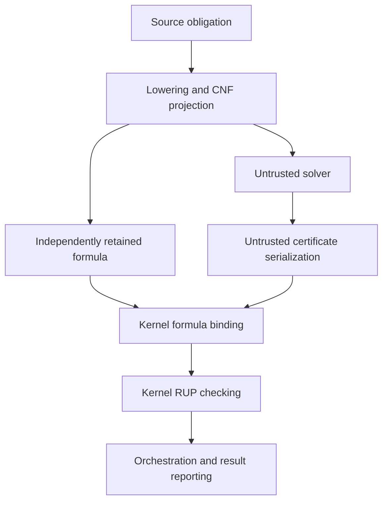

# A02: trusted proof-kernel boundary

Inventory baseline: `349fb7300943d7db9ebd46f76673cbd386d074b2` on
`specification`. Scope: `internal/lrat/`, `prove/`, `spec/lean/` and the
interfaces through which they obtain authority. This is a trust inventory,
not a claim that every theorem in the repository proves the entire compiler.
The contracts in `docs/spec/125-verification.md` remain authoritative.

## Acceptance boundary

`internal/lrat.Check(formula, certificate)` accepts only by returning a nil
error. `CheckWords(words)` establishes UNSAT **only for the embedded formula**.
`CheckWordsAgainst(formula, words)` additionally binds that formula to the
caller's independently retained DIMACS obligation. Counters accompanying an
error are partial progress, never evidence of acceptance. `WordsMatchFormula`
is an identity/framing predicate, not a certificate checker.

The Go kernel imports only `fmt`, `strconv`, and `strings`; its dependency test
requires explicit review of new imports. Its DIMACS parser and LRAT text/word
decoders are trusted acceptance code: parsing cannot simply be moved outside
this boundary without validating the resulting representation. The producer's
parser and encoder in `prove/lrat_encode.go` are different: their output is
untrusted and must pass the kernel. The Go kernel is hand-written, not extracted
from the Lean proof. Differential tests are evidence, not a universal refinement.

A02 moves exact-formula comparison into the leaf kernel. It compares parsed
DIMACS literals directly with the length-prefixed word payload, preserving
clause order, literal order, and duplicates. It no longer calls the producer's
`EncodeLRATWords` to decide identity. Compatibility APIs remain in
`prove/lrat.go`; serializer and clause-ID remapping live in `lrat_encode.go`.
No ARM64/RV64 code or theorem is changed.

## Inputs and assumptions by authority

| Input or assumption | Owner / check | Residual trust or limit |
| --- | --- | --- |
| Source text, imports, AST, type information, contracts, global environment | `prove.TheoremsWith`, `prepare`, `deciderInputs`; compiler/typechecker | Correct parsing, typing and the intended statement are prerequisites to a source claim. LRAT cannot establish them. |
| Hypotheses, refined domains, uninterpreted operations, trap obligations | `problem.go`, `CNFFor`, `asm` lowering | Translation must preserve the source counterexample relation; UNSAT of an unrelated CNF proves nothing about source. |
| Independently retained CNF | caller; `CheckWordsAgainst` | Caller must retain the actual obligation, not take the expected formula from the solver. DIMACS syntax is checked; semantic correspondence to source is separate. |
| DIMACS header, variable counts, clause counts, literal signs and magnitudes, termination, ordered clauses | `ParseDIMACS` | Host integer parsing, slice operations and standard library implementation; lexical differences are allowed, logical clause reordering is not identity. |
| Text certificate bytes, command IDs, deletions, live references, hints, target clauses | `Check`, scanner, database, `rup` | RUP-only; no RAT acceptance. Increasing addition IDs, live references, propagation and historical empty-clause derivation are checked. |
| Word magic, variable/clause counts, payload and step lengths, tags, IDs, literals, hints, exact end | `CheckWords` | Length arithmetic and variable mapping are trusted Go code. Truncation and trailing words are rejected. |
| Word allocation hints (5..7) | Go ignores them for identity; Oak validates capacities/preflight | Not logical formula identity. Acceptance sets can differ for resource limits without implying logical disagreement. |
| Assignment generations, dense/compact variable mapping, live database, empty flag | private Go kernel state | Mutable implementation correctness, generation wrap clearing, and alias-free use remain trusted. Inputs must not be concurrently mutated. |
| Memory, CPU, text limit, integer widths | Go runtime and host | Allocation exhaustion can prevent completion. No acceptance is inferred from timeout, panic, crash or partial counts. Text limit is not a total resource sandbox. |
| Solver executable, environment, exit status, stdout, model, proof file | `sat.go`, `prove/solver/*` | Search is untrusted for LRAT. `SATOutcome.Unsatisfiable` alone is not proof; models need `ModelSatisfies` and source-level confirmation as appropriate. |
| Word encoder, clause-ID densification, serializer syntax parser | `lrat_encode.go` | No acceptance authority. Encoder bugs may cause refusal; kernel binding prevents substituting an easier formula. |
| BDD verdict/status, node budget, winner, lowered flag, enumeration results, callbacks | `prove.go`, `ResolvePending`, `GoDecision`, `GoEnumeration` | Separate decision routes trust the decider/interpreter and orchestration. They are not converted into LRAT proofs by this change. |
| Candidate laws, invariants, liveness/protocol obligations and witnesses | `laws.go`, `synthesis.go`, `liveness.go`, `protocols.go`, `witness.go` | Candidate generation and reporting must preserve the obligation and distinguish bounded evidence from proof. They do not belong in the LRAT leaf. |
| Native function, declaration and generated equality CNF | `native_certificate.go`, `native_bitwise_certificate.go` | LRAT establishes UNSAT of the constructed obligation; source/native correspondence and admitted instruction subset remain separate contracts. |
| Lean executable, imports, filesystem projection, supplied projection string, diagnostics | `lean.go` | General runner trusts executable custody, equality of file and supplied string, statement-range attribution, and diagnostics. It is not an axiom-audited proof-kernel API. |
| Lean statement, theorem parameters and hypotheses | each theorem in `spec/lean` | A checked conditional theorem establishes only its conclusion under its premises. No absence-of-`axiom` scan establishes adequacy of the statement. |
| Lean foundations and kernel implementation | pinned `lean-toolchain`, theorem-specific audits | Foundational allowlist is `propext`, `Classical.choice`, `Quot.sound` where specified. Imported transitive dependencies must also be audited. |
| `bv_decide` native evaluation | native guard theorem audit | Explicitly enumerated generated native axioms also trust Lean's native evaluation/compiler path; not kernel-only reduction. Never widen to a wildcard allowlist. |
| Extraction/projection source, generated Lean, source custody | extraction drift tests, `checked_bundle_sources.go`, `checked_image_sources.go` | Token/source equality prevents drift but does not itself prove a general extractor or compiler correct. Checked bundle/image paths have their own stronger custody contracts. |
| Oak array views, fuel, accepted run | LRAT extracted model | `Option.none`/fuel exhaustion is not acceptance. UInt32 view representability is explicit in binding-refinement contracts. |
| Allocation addresses, ownership conversion, free and normal return | lifecycle model and FFI | Fresh distinct non-null blocks, identity-preserving own/disown, borrowing checker normal return, `free(NULL)` no-op. Foreign implementations and abnormal termination remain outside that protocol proof. |
| Executable bytes, relocations, ABI, register/memory state, load extents | ARM64/RV64 models and byte/call/load regressions | Pinned local refinements have explicit live-base, layout, no-fault and non-wrapping premises. They are not a full native checker execution theorem. |
| ISA model fidelity, loader, OS, compiler/bootstrap, hardware | external execution environment | Required for claims about actual execution rather than the modeled machine. Preserve existing platform gates. |

## Formal evidence and exact limits

| Modules | Established boundary | Assumptions that must not be silently discharged |
| --- | --- | --- |
| `LRATRUPExtracted`, `LRATRUPSoundness`, `LRATRUPValidity`, `LRATTrail` | Production RUP entails its clause; validation and scratch restoration | Local RUP theorem requires valid live clauses, sufficient capacity and zero declared scratch; outer theorems derive these. |
| `LRATCheckerState`, `LRATStore`, `LRATInitial`, `LRATRecord`, `LRATSteps`, `LRATRecordSoundness` | Complete extracted record acceptance refutes decoded initial formula | Accepted execution of the extracted checker, not an assertion that the actual executable ran it. No caller-supplied propagation trace. |
| `LRATFormulaBinding`, `LRATBindingExtracted`, `LRATBindingModel`, `LRATBoundSoundness` | Identity relation, production/model refinement and earlier binding composition | Earlier composition requires expected decode success; binding iff model uses representable array lengths and sufficient fuel for completeness. |
| `LRATBoundRecord`, `LRATAdmission` | `production_bound_record_sound`; `production_bound_cnf_sound` additionally concludes successful expected CNF decoding | Two accepted extracted calls (binding and checking). Stronger than the earlier composition; still not source-to-CNF correctness. |
| `LRATBounds*`, `LRATPreflight*`, `LRATLifecycle*` | Non-wrapping arithmetic, admission, normally returning resource protocol | Allocation success and external memory/ownership semantics as above. |
| `LRATARM64*`, `LRATRV64*`, `LRATNativeGuards`, `LRATNativeRefinement`, `LRATHeaderMemory` | Specific pinned guard bytes, calls and loads | Per-theorem state/memory/ABI premises and native-evaluation axiom policy. Full compiled record execution remains separate. |
| `CNF*`, `Tseitin*`, `SolverLaws`, `SolverAllocation`, `SolverScheduling` | Projection, gate, search and sizing properties | Use the actual theorem's admitted fragment and premises; these do not make search an acceptance oracle. |
| Remaining `Oak/*` and generated fixture modules | Source, optimization, assembler, object/image and library properties | Per-module model, theorem premises, exact artifact custody and axiom closure. Their presence does not enlarge the LRAT claim. `Oak.Kernel` models parallel compute kernels, not proof acceptance. |

For detailed contracts and existing formal gates see
[`125-verification.md`](../spec/125-verification.md), especially the production
record, bound-CNF, lifecycle and native guard sections. This change does not
claim a new Lean theorem about the Go implementation.

## Prioritized remaining work

1. **Orchestration authority:** make evidence kinds explicit so BDD decisions,
   finite enumeration, LRAT acceptance and audited Lean proofs cannot be
   confused. Preserve existing public status behavior until callers migrate.
2. **General Lean runner:** bind the inspected projection to the executed file,
   fail closed on unaccounted diagnostics, and audit exact theorem types and
   transitive axioms before granting a stronger proof status. Successful process
   exit and absence of an in-range error are insufficient by themselves.
3. **Go refinement:** prove the direct DIMACS/word identity relation and checker
   implementation refine the formal model, or replace them with a separately
   verified representation boundary. Current regression/differential evidence
   is deliberately not labelled formal refinement.
4. **Source correspondence:** compose the concrete admitted lowering/encoding
   path with bound-CNF soundness. Keep unsupported fragments open rather than
   extending acceptance on solver assertions.
5. **Native closure:** extend existing ARM64/RV64 byte refinements through the
   remaining caller setup, control flow, allocation/FFI and whole checker run.
   Retain all current proof obligations and axiom policies.

## Regression evidence

`internal/lrat/binding_test.go` uses literal records independent of the producer
encoder. It checks substitution by a different same-shaped satisfiable formula,
clause/literal ordering and duplicates, malformed framing, allocation-hint
independence, and proof refusal after identity succeeds. Existing public LRAT
and kernel tests exercise compatibility; the dependency test continues to guard
the leaf. Run `go test -race ./internal/lrat ./prove` and the compiler LRAT gate.
